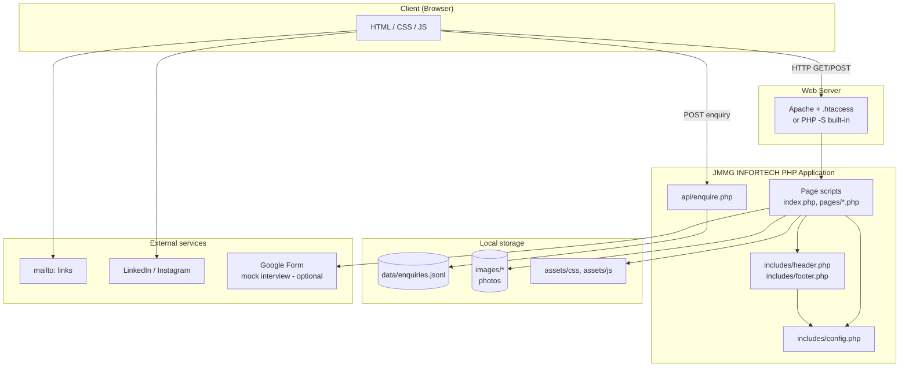
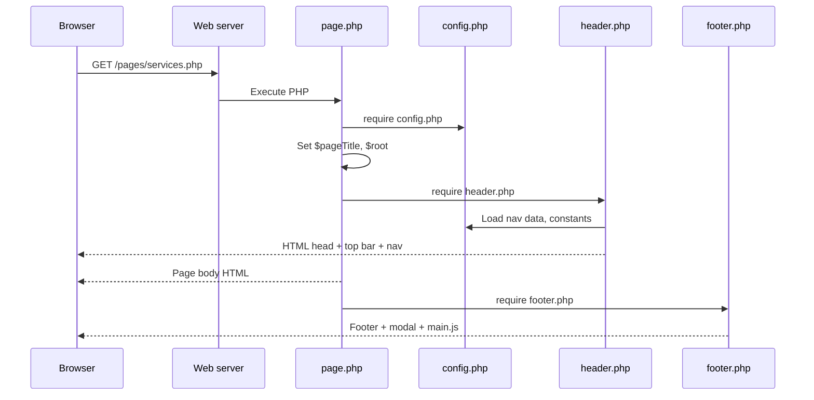
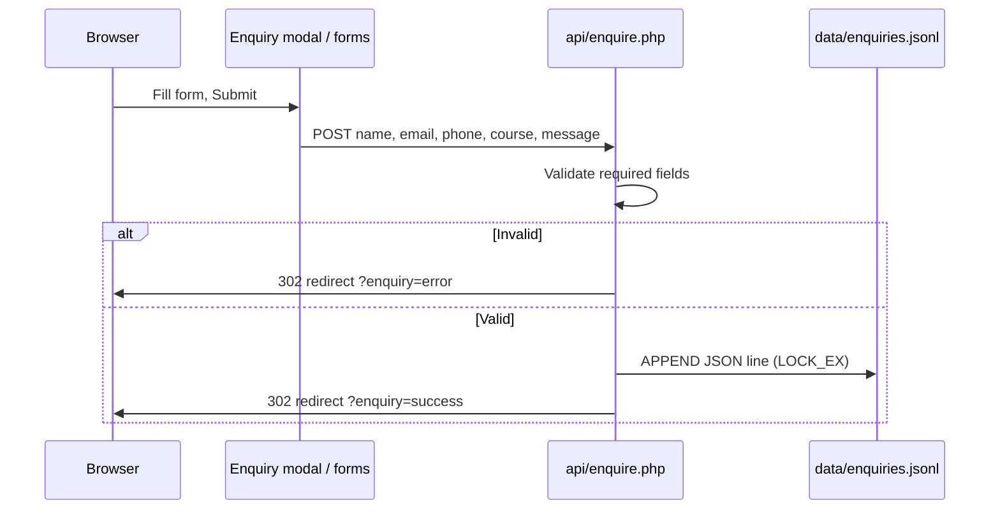
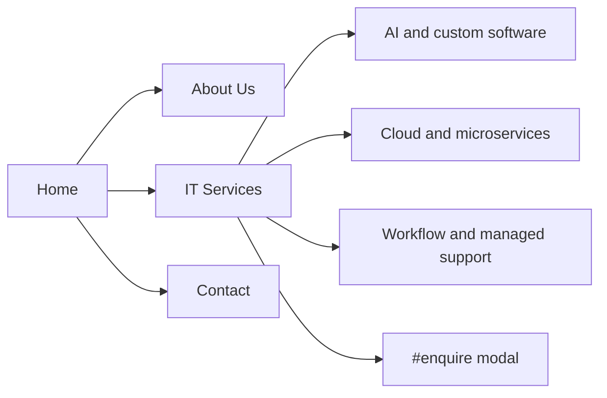
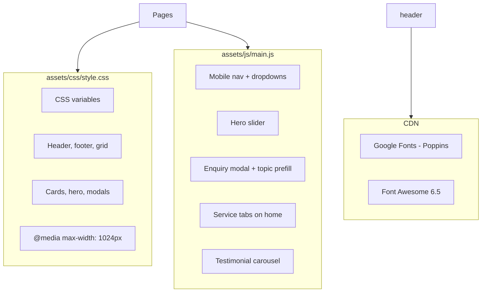
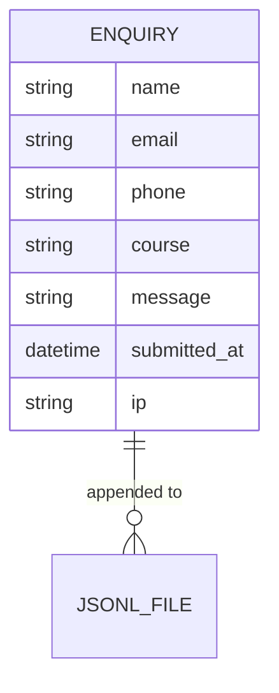
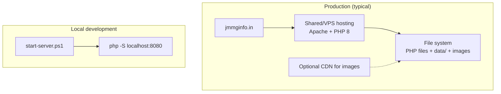
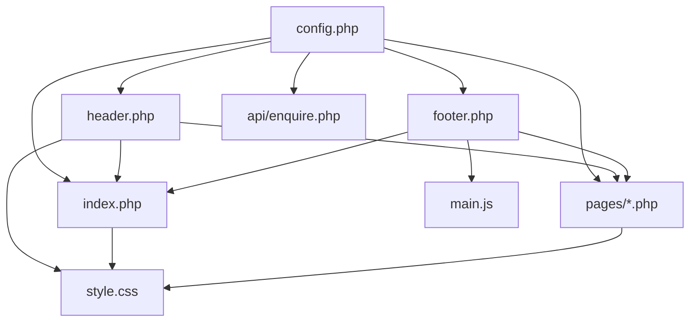

# JMMG INFORTECH — System Design

**Document version:** 1.0  
**Application:** Corporate marketing & lead-capture website  
**Stack:** PHP 8.x (server-rendered), HTML/CSS/JS, Apache or PHP built-in server  

---

## 1. Executive summary

JMMG INFORTECH is a **monolithic, server-side rendered (SSR)** PHP website. There is no separate API layer, database, or frontend framework. All business content lives in PHP arrays in `includes/config.php`; pages compose shared layout (`header` / `footer`) and render HTML. The only write path is the **enquiry API**, which appends leads to a JSONL file on disk.

| Attribute | Choice |
|-----------|--------|
| Architecture | Monolith, multi-page PHP (MPA) |
| State | Stateless HTTP (session not used) |
| Persistence | File-based (`data/enquiries.jsonl`) |
| Auth | None (public site) |
| CMS | None (code-driven content) |

---

## 2. High-level architecture



---

## 3. Directory structure (logical layers)

```
YUGRATHO/
├── index.php                 # Home page
├── pages/                    # Presentation layer (route handlers)
│   ├── about.php
│   ├── careers.php
│   ├── contact.php
│   ├── courses.php
│   ├── mock-interview.php
│   ├── placement.php
│   ├── resources.php
│   └── services.php
├── includes/                 # Shared layout + configuration
│   ├── config.php            # Site constants + all content arrays
│   ├── header.php            # Top bar, nav, <head>
│   └── footer.php            # Footer, enquiry modal, scripts
├── api/                      # Write-only endpoint
│   └── enquire.php
├── assets/                   # Static front-end
│   ├── css/style.css
│   └── js/main.js
├── images/                   # Public image assets
├── data/                     # Runtime data (enquiries)
│   └── enquiries.jsonl
├── docs/                     # Developer docs (not loaded by app)
│   ├── version.txt
│   └── SYSTEM_DESIGN.md
├── .htaccess
└── start-server.ps1          # Local dev helper
```

---

## 4. Request flow

### 4.1 Page view (GET)



### 4.2 Enquiry submission (POST)



---

## 5. Routing & pages

There is **no front controller**. Each URL maps to a physical PHP file.

| URL path | Handler | Purpose |
|----------|---------|---------|
| `/` or `/index.php` | `index.php` | IT services homepage and service finder |
| `/pages/about.php` | About, service groups, locations |
| `/pages/services.php` | IT service directory (anchor sections) |
| `/pages/contact.php` | IT enquiry form and company contact details |
| `/pages/courses.php` | Redirects to `/pages/services.php` (legacy URL) |
| `/pages/placement.php` | Redirects to `/pages/services.php` (legacy URL) |
| `/pages/careers.php` | Redirects to `/pages/services.php` (legacy URL) |
| `/pages/resources.php` | Redirects to `/pages/services.php` (legacy URL) |
| `/pages/mock-interview.php` | Redirects to `/pages/services.php` (legacy URL) |
| `/api/enquire.php` | POST only — lead capture |

`.htaccess` sets `DirectoryIndex index.php` and disables directory listing. No URL rewriting to clean paths.

---

## 6. Navigation & information architecture



**Header** (`includes/header.php`): IT services, About, Contact, and the enquiry action.  
**Footer**: IT service links, company contact details, and social links.

---

## 7. Configuration & content model

All dynamic copy is centralized in `includes/config.php`:

| Data structure | Used for |
|----------------|----------|
| `SITE_*` constants | Contact, social, branding |
| `$heroBanners` | Home carousel |
| `$majorServices` | Home “Major Services” cards |
| `$stats` | Home stats bar |
| `$services` | Services page sections |
| `$itServicesNav` | IT Services nav dropdown |

**Helper functions:**

- `e()` — HTML escape  
- `navEnquiryTopic()` — enquiry modal attributes  
- `pageUrl()` / `isActivePage()` — URL helpers  

There is **no admin UI**; content changes require editing `config.php` and redeploying.

---

## 8. Front-end architecture



| Feature | Implementation |
|---------|----------------|
| Mobile menu | Slide-out panel + backdrop, tap-to-toggle dropdowns |
| Enquiry | Modal `#enquireModal`, POST to `api/enquire.php` |
| IT / Training dropdowns | CSS hover (desktop), `.open` class (mobile/touch) |
| Hero | Auto-rotate slides every 6s |

---

## 9. Data persistence



- **File:** `data/enquiries.jsonl` (one JSON object per line)  
- **Created on first submission** if `data/` missing  
- **No read API** in the app (manual file inspection / future admin tool)  
- **No encryption at rest** (filesystem permissions only)

---

## 10. Security & operational notes

| Area | Current state | Recommendation |
|------|---------------|----------------|
| Authentication | None | Add admin auth if enquiry dashboard needed |
| Input validation | Trim + required fields | Add email/phone format checks, CSRF token |
| XSS | `e()` on output | Keep using `e()` for all user-facing echoes |
| SQL injection | N/A (no DB) | — |
| File upload | None | — |
| Sensitive config | `MOCK_INTERVIEW_KEY` in config | Move to env var; block `docs/` (`.htaccess` present) |
| Rate limiting | None | Add on `api/enquire.php` for production |
| HTTPS | Deployment-dependent | Enforce TLS on production host |

---

## 11. Deployment topology



**Deploy units:** upload PHP files, `assets/`, `images/`, ensure `data/` is writable by PHP, configure Apache document root to project root.

---

## 12. External integrations

| Integration | Type | Trigger |
|-------------|------|---------|
| Email | `mailto:info@jmmginfo.in`, `sales@jmmginfo.in` | Top bar, footer, contact |
| LinkedIn / Instagram | External URLs | Footer, contact |
| Google Form | Redirect from `mock-interview.php` | Campus key + `MOCK_INTERVIEW_FORM_URL` |

No server-side email sending (SMTP) is implemented today.

---

## 13. Scalability & evolution paths

Current design fits **low–medium traffic marketing site**. If requirements grow:

| Need | Suggested direction |
|------|---------------------|
| CMS for marketing | WordPress headless, Strapi, or custom admin |
| Lead management | DB (MySQL) + admin dashboard; email notifications |
| Clean URLs | Front controller (`public/index.php` + router) |
| API separation | REST API + React/Vue SPA (larger rewrite) |
| Search / blog | DB-backed posts or headless CMS |
| Analytics | Google Analytics / Tag Manager snippet in header |
| Caching | Opcode cache (OPcache), static asset CDN |

---

## 14. Component dependency diagram



---

## 15. Key design decisions

1. **PHP arrays over database** — Fast to build and host; no DB hosting cost; trade-off is no dynamic admin.  
2. **Shared layout includes** — DRY header/footer; `$root` path prefix for subpages.  
3. **Single enquiry endpoint** — Simple lead capture without email infrastructure.  
4. **File-based versioning in `docs/`** — Does not affect runtime or UI.  
5. **Mobile-first nav refactor** — Slide-out menu, dropdown parity with IT Services for Training Program.

---

*For change history see `CHANGELOG.md`. For release versioning see `VERSIONING.md` and `docs/version.txt`.*
